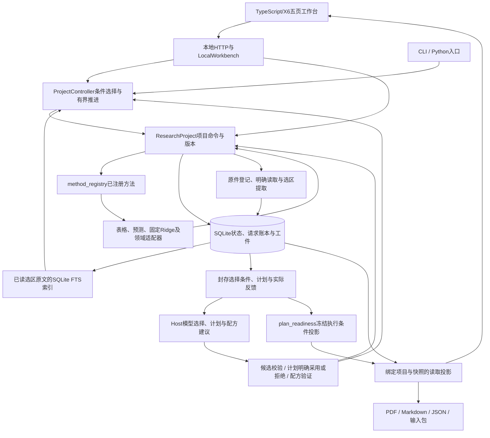
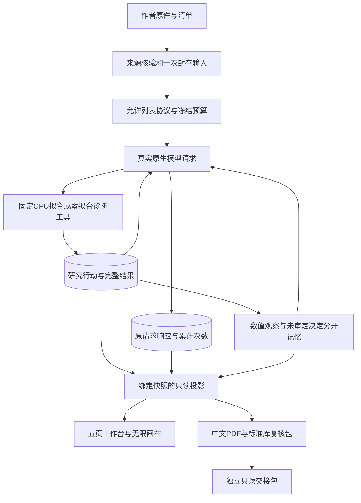

# 产品与架构

产品目标是持续自适应研究工作台：共用项目、能力接口和反馈循环，按课题条件选择领域方法。当前 Python＋SQLite＋TypeScript/X6 基座已经接通项目控制器、注册方法、来源检索、模型建议、设计版本与五页工作台，能够完成受控的本地研究闭环。研究判断质量、自适应收益和线上协作仍需实际任务验证。稳定目标与阶段见[产品计划](plan.md)，基线见[底层模块与依赖](architecture/foundation.md)和[状态/接口契约](architecture/research-contracts.md)；方法与两层迭代见[自适应设计](research/adaptive-research.md)。

本页以当前本地代码为准。研究设计、固定模型验证和计划执行条件投影按本地实现范围交付，远程发布与线上部署另核对。P02 ChemoTopoChip、C01、钢材及软件检查保留各自数据、账本与领域含义，不能以其中一个案例代替通用项目能力。AgentArts已有有限真实调用、控制台原回答导入及明确采用或拒绝的记录；平台API自动回流、账号权限、多人在线协作和通用远程执行尚未完成，详情见[平台接入](research/agentarts-first-connection.md)。

开发定位先用[后端索引](../.agent/indexes/backend.md)、[接口索引](../.agent/indexes/interfaces.md)与[组件索引](../.agent/indexes/components.md)。

## 当前本地运行架构

图中模型建议通过原Host账本保存，不另设执行权限。行动选择至多提交一个合资格候选；计划采用只保存研究计划修订；配方候选经验证和明确保留或回退后，才供后续控制器读取。方法执行前登记请求与预算预留，结果保存后提交；同ID恢复原请求，未知执行保留待核对。有限连续推进复用这些步骤，不越过预算、未决请求或明确停点。

| 部分 | 当前模块入口 | 已接通的职责 |
|---|---|---|
| 项目与保存 | [research_project.py](../src/autoresearch/research_project.py) | 单项目单Run，保存目标、原始输入、来源、行动、观察、计划、研究者意见、设计修订及累计预算；请求恢复与版本检查沿原账本处理 |
| 工作台管理与服务 | [local_workbench.py](../src/autoresearch/local_workbench.py)、[project_workbench.py](../src/autoresearch/project_workbench.py) | 管理本地项目、HTTP读取及显式启用的本地操作；CLI复用同一项目内核，见[工作台用法](local-workbench.md) |
| 条件选择与执行 | [project_controller.py](../src/autoresearch/project_controller.py)、[research_methods.py](../src/autoresearch/research_methods.py)、[method_registry.py](../src/autoresearch/method_registry.py) | 根据已有反馈、输入条件、来源及预算生成候选；冻结已选请求，再调用已注册适配器，保留领域评价协议 |
| 表格与预测核验 | [tabular_quality_adapter.py](../src/autoresearch/tabular_quality_adapter.py)、[grouped_quality_adapter.py](../src/autoresearch/grouped_quality_adapter.py)、[numeric_association_adapter.py](../src/autoresearch/numeric_association_adapter.py)、[prediction_adapter.py](../src/autoresearch/prediction_adapter.py) | 表格质量、分组画像、数值关联、保存预测的基线、分组、敏感性与负对照；不是任意算法执行器 |
| 原始表格固定训练 | [ridge_validation_adapter.py](../src/autoresearch/ridge_validation_adapter.py) | 小型表格的训练折内StandardScaler、固定Ridge随机/分组交叉验证，保存OOF、系数及拟合尝试；负对照读取已保存预测，范围见[研究设计](research-design.md) |
| 来源与知识 | [source_evidence_adapter.py](../src/autoresearch/source_evidence_adapter.py)、[project_knowledge.py](../src/autoresearch/project_knowledge.py) | 捕获原件，明确读取后对选区原文建立FTS索引；检索保留原文及位置，进入问题澄清、设计、准备和解释，不自动索引来源整篇或确认其主张 |
| 模型建议与计划 | [host_model_selection.py](../src/autoresearch/host_model_selection.py)、[research_plan_proposal.py](../src/autoresearch/research_plan_proposal.py) | 封存上下文与原回答，校验协议、引用及版本；计划建议保留待审、采用和拒绝状态，工具原结果独立保存，见[Host用法](host-model-selection.md) |
| 计划执行条件 | [plan_readiness.py](../src/autoresearch/plan_readiness.py) | 从请求冻结上下文纯读取候选、方法阻塞和扣除预留后的预算余额，投影到工作台与报告；不判读计划正文，不代表当前项目资格或科学审查通过 |
| 设计与配方版本 | [project_design.py](../src/autoresearch/project_design.py)、[research_design.py](../src/autoresearch/research_design.py)、[project_recipe.py](../src/autoresearch/project_recipe.py)、[recipe_improvement.py](../src/autoresearch/recipe_improvement.py) | 设计绑定、版本、导入导出、跨项目资源复用及使用记录；配方修改保留实际反馈、验证与采用或回退，见[RSI实现](recipe-research/rsi-delivery.md) |
| 五页与研究画布 | [local-workbench.ts](../frontend/src/local-workbench.ts)、[project-pages.ts](../frontend/src/project-pages.ts)、[project-flow.ts](../frontend/src/project-flow.ts)、[local-model.ts](../frontend/src/local-model.ts) | 总览、研究、实验、知识、成果，X6研究记录画布、来源阅读、指标、失败与模型记录；界面布局和研究状态分开保存 |
| 结果与原件导出 | [project_report.py](../src/autoresearch/project_report.py)、[host_model_report.py](../src/autoresearch/host_model_report.py) | 读取当前项目及Host证据快照，导出PDF、Markdown、JSON和输入包，保留原回答及拒绝记录；不因导出而执行研究或恢复请求 |

新方法仍需编写适配器、注册资格条件并接入结果展示。当前原始数据训练限定至多512行、固定Ridge协议；内置设计和部分反馈修订范围有限。项目FTS已进入决策上下文，旧C01/P02条件记忆尚未成为所有项目共用的经验层。RSI的候选选择和允许执行判据不能代替科研质量提升证据。

## P02专项的历史证据链

以下记录P02专项及早期共用内核的演进，保留原研究范围和运行含义；当前项目主入口、注册方法数量及计划能力以上节为准。

图表示实际职责与证据流，不表示每轮必须走完所有工具。模型可以产生无效参数、错误解释或预算耗尽；原响应保留，不补造提案、记忆或停止行动。

| 层 | 实际入口 | 边界 |
|---|---|---|
| 初始本地项目切片 | `research_project.py`、`saved_oof_adapter.py`、`scripts/run_research_project.py` | A4先接单Run、P02工具和完整反馈；A5接来源，A6加只读界面，后续已扩展为上节的项目运行时 |
| 早期三方法共用内核 | `method_registry.py`、`steel_audit_adapter.py`、`source_integrity_adapter.py` | 当时验证P02、MPa²/MSE、软件I/O契约语义分离；当前注册表已增加表格、预测与固定训练方法 |
| 来源核验 | `chemotopo_data.py`、`chemotopo_project.py` | 固定作者文件、原坐标、HDF5及OME元数据；不执行作者管线，不凭染料名确认ALP |
| 配置与封存 | `experiment_protocol.py`、`configured_iteration.py`、`prepared_continuation.py` | 仅允许P02交互Ridge，创建时核验并封存输入；后续不反复重建Excel，改协议／代码／预算须新研究 |
| 原生模型选择 | `compact_iteration.py`与各独立控制器 | 固定候选、当前状态和累计请求约束；宿主附来源与最新行动ID，不表示模型主动引用或已阅读 |
| 请求与费用 | `c01_local_loop.py`、`c01_cloud_loop.py`、`ollama_cloud.py`；新高推理层`reasoning_profile.py` | 预留、原响应、received恢复、未知发送不自动重发；已有免费额度检查不是供应商硬消费上限 |
| 零拟合研究诊断 | `residual_diagnostics.py`、`diagnostic_research.py`、`diagnostic_followup.py`、`iterative_diagnosis.py` | 保存OOF的分组残差和固定策略对照；完整结果落账，模型请求只带摘要；不新增拟合或估计spot测量可靠性 |
| 提案与条件记忆 | `postrun_research.py`、`postrun_revision.py`、`research_memory.py` | 数值观察与agent_decision分开，精确scope、来源版本与active／retired资格；提案不自动执行 |
| 投影与报告 | `configured_iteration_view.py`、`postrun_revision_view.py`、`diagnostic_view.py`、报告模块 | 实际调用与行动绑定，原始理由未经科学审定；开发助手评估不是研究模型或科学审稿人的批准 |
| 展示与交接 | `frontend/`、`chemotopo_studio.py`、`chemotopo_bundle.py`、`snapshot_viewer.py` | 五页、分类卡片、独立阅读、真实图表与PDF／ZIP；GET只读，交接包不能继续研究 |

## P02数值结论与研究判断

P02该组比较复用870个共同材料键、35个整纹理留出折、已知化学类别和已测同分区平坦对照。已经查看这些数据并反复比较候选，因此不是无偏最终盲测，不支持独立实验室、临床或机制推断。主指标MAE与次项Spearman、零处理与聚合权重、特征输入与正则参数分别标注，不能换比较轴宣布成功。

详见[来源资格](chemotopo-data.md)、[HDF5／OME读取](chemotopo-project.md)、[固定预测](chemotopo-prediction.md)、[配置化迭代](configured-iteration.md)与[实验后研究](postrun-research.md)。原ALP通道、对象／导出列映射和零对象规则仍未放行。

## 状态、恢复与记忆

请求账本是“发了几次、收到什么、是否未知发送”的依据；研究账本是“真正提交了哪些行动”的依据。两者可能在中断处暂时不同。预算停止的completed不等于研究stopped，active记忆也不等于科学事实。

状态读取只报告当前账本，原ID恢复才接续对应请求；页面刷新或报告收集不自动resume、不调用模型、不重置预算。未能从账本确定的用量保持未知。项目FTS与旧条件记忆各按其来源保存，索引命中、active记忆或模型计划均不能替代科学核验或真实运行验收。

## 已交付界面与历史底座

采用已批准的悬浮玻璃导航、实色正文／图文卡片与X6无限画布，默认总览，研究、实验、知识、成果分别成页。移动节点只改变按案例和快照隔离的本浏览器布局，不改研究状态。界面源码在`frontend/`，构建生成`src/autoresearch/web/`；UI验收仍须运行、截图并实看。

当前项目报告绑定项目与Host证据快照，原回答及输入原件按报告协议保留。历史P02独立工作台的PDF和复核ZIP绑定该专项封存快照；标准库verify.py仅重算保存预测的数值一致性，该只读包不带数据库、模型原响应、thinking、账户或浏览器状态，不能训练或启动新研究。两种导出范围分别按[项目报告](local-workbench.md#当前证据怎样进入报告)和[独立交接包](portable-workbench.md)核对。

C01旧实现继续提供持久请求、固定计算、条件记忆和冻结交付等复用基础。历史入口为[C01研究工具](c01-research.md)、[云记忆接线](c01-cloud-memory.md)和[独立AgentArts代码工具](../agentarts/c01-sensitivity/README.md)。独立代码节点的历史运行与当前计划建议试接分别留证，均不证明产品已完成Runtime、自动回调、Trace接线或生产鉴权。

P02专项仍需作者列／通道／对象映射、零对象定义和重复结构。当前团队接续同时覆盖真实课题、方法与配方，按[队员交付](team-handoff.md)保留原始来源和实际行动证据。核心协议、控制器、费用和最终交付由主流程管理。新增云调用仍遵守原免费额度与5元现金上限边界，现金结算未知不重置为0；不因复制目录、换模型推理档位或旧平台成功而新增授权。
