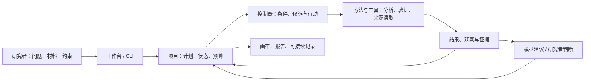

# 产品与系统架构

Auto Research 是持续研究工作台：研究者给出问题、材料和约束，系统在同一个项目里保存计划、证据、行动、结果及后续决定，供人理解、修订和接续。

## 系统如何工作

项目核心为 Python，状态与请求账本使用 SQLite；前端是 TypeScript 和 X6。本地工作台、CLI 共用项目与方法；模型建议通过 Host 请求保存原输入、回答及采用或拒绝记录。来源原文可建立项目全文索引，供相关决策检索。

| 部分 | 当前职责 | 主要入口 |
|---|---|---|
| 项目与状态 | 保存问题、输入、计划、来源、预算、行动和观察 | [ResearchProject](../src/autoresearch/research_project.py) |
| 调度与执行 | 按条件准备候选，调用已注册方法，登记、保存结果并恢复请求 | [ProjectController](../src/autoresearch/project_controller.py)、[方法目录](../src/autoresearch/method_registry.py) |
| 方法与数据 | 表格质量、画像、关联、固定 Ridge 验证、保存结果诊断及领域适配 | [研究设计](research-design.md) |
| 模型与配方 | 提出选择、计划或配方建议；保留原始请求和明确采用/拒绝记录 | [模型入口](host-model-selection.md)、[配方接入](recipe-research/integration.md) |
| 知识与证据 | 保存来源、定位原文、项目全文检索与显式复用历史案例 | [知识服务](knowledge.md)、[方法案例](project-experience.md) |
| 工作台与成果 | 五页工作台、研究画布、来源阅读、成果导出 | [工作台](local-workbench.md)、[前端设计](../DESIGN.md) |

## 已实现与待完成

已有受控的本地研究闭环：在明确条件与预算内执行已注册方法，保存真实反馈，提出或修改计划，再通过已有入口继续行动。请求身份、结果保存和未知执行的处理支持恢复；这些是执行可靠性的能力。

研究判断仍有明显缺口：研究问题、相互竞争的解释、结果如何改变判断和下一行动，尚未贯穿为自动且可靠的完整过程；部分分析和决定仍由操作者组织。现有方法以有限适配器和固定表格协议为主，不是任意研究流程。配方选择或多轮执行本身不能证明科研质量提升。

当前是本地单写入方、每项目一个 Run。AgentArts 已有人工导入回答的有限接入记录；自动回流、账号权限、多人在线协作与通用远程执行尚未完成。真实研究价值和两位队员交接仍需要实际使用证据。

研究结论、模型解释和工具观察应分别阅读，模型建议不能直接当作已验证科学事实。研究状态和执行状态分开，预算用尽或执行停止不等于研究问题已解决。

## 深入资料

- [状态和能力契约](architecture/research-contracts.md)：项目、运行、行动、观察和恢复边界。
- [底层职责与依赖](architecture/foundation.md)：目标架构与已有适配边界；目标端口并不表示全部实现。
- [产品概念与研究主线](research/product-concepts.md)：研究者的完整使用路径、研究配方及评价。
- [文档入口](README.md)：当前说明、运行入口和案例。
