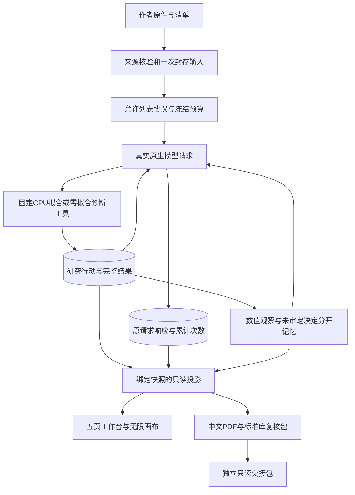

# 产品与架构

产品目标是基于 AgentArts 的持续自适应研究工作台：共用项目、能力接口和反馈循环，按课题条件选择领域方法。稳定目标与阶段见[产品计划](plan.md)，基线见[底层模块与依赖](architecture/foundation.md)和[状态/接口契约](architecture/research-contracts.md)；方法与两层迭代见[自适应设计](research/adaptive-research.md)。A4 已实现[本地项目切片](project-slice.md)：单个 OOF 方法、固定策略与持久恢复，统一接口其余部分仍待建设。

当前实现主要围绕 P02 ChemoTopoChip：核验作者来源，封存可复算输入，让真实模型在允许的本机工具中选择行动，把实际结果、未审定判断和条件记忆展示在只读工作台。C01与钢材路径作为已有底座和历史案例保留。P02不是所有课题的默认数据或方法；统一项目控制器仍待接线，产品到AgentArts的接入继续暂缓。以下各节记录现有实现，不将目标架构当作已交付。

开发定位先用[后端索引](../.agent/indexes/backend.md)、[接口索引](../.agent/indexes/interfaces.md)与[组件索引](../.agent/indexes/components.md)。

## 当前P02证据链

图表示实际职责与证据流，不表示每轮必须走完所有工具。模型可以产生无效参数、错误解释或预算耗尽；原响应保留，不补造提案、记忆或停止行动。

| 层 | 实际入口 | 边界 |
|---|---|---|
| 初始本地项目切片 | `research_project.py`、`saved_oof_adapter.py`、`scripts/run_research_project.py` | A4 首先接单 Run、P02 工具和完整反馈；A5 后续接来源，A6 加只读界面，下行说明 A7 跨域扩展 |
| 三方法共用内核 | `method_registry.py`、`steel_audit_adapter.py`、`source_integrity_adapter.py` | 注册式来源/执行/反馈，经同一 ResearchProject 保存；P02、MPa²/MSE、软件 I/O 契约语义分离，来源选区经既有 FTS，不改冻结账本 |
| 来源核验 | `chemotopo_data.py`、`chemotopo_project.py` | 固定作者文件、原坐标、HDF5及OME元数据；不执行作者管线，不凭染料名确认ALP |
| 配置与封存 | `experiment_protocol.py`、`configured_iteration.py`、`prepared_continuation.py` | 仅允许P02交互Ridge，创建时核验并封存输入；后续不反复重建Excel，改协议／代码／预算须新研究 |
| 原生模型选择 | `compact_iteration.py`与各独立控制器 | 固定候选、当前状态和累计请求约束；宿主附来源与最新行动ID，不表示模型主动引用或已阅读 |
| 请求与费用 | `c01_local_loop.py`、`c01_cloud_loop.py`、`ollama_cloud.py`；新高推理层`reasoning_profile.py` | 预留、原响应、received恢复、未知发送不自动重发；已有免费额度检查不是供应商硬消费上限 |
| 零拟合研究诊断 | `residual_diagnostics.py`、`diagnostic_research.py`、`diagnostic_followup.py`、`iterative_diagnosis.py` | 保存OOF的分组残差和固定策略对照；完整结果落账，模型请求只带摘要；不新增拟合或估计spot测量可靠性 |
| 提案与条件记忆 | `postrun_research.py`、`postrun_revision.py`、`research_memory.py` | 数值观察与agent_decision分开，精确scope、来源版本与active／retired资格；提案不自动执行 |
| 投影与报告 | `configured_iteration_view.py`、`postrun_revision_view.py`、`diagnostic_view.py`、报告模块 | 实际调用与行动绑定，原始理由未经科学审定；开发助手评估不是研究模型或科学审稿人的批准 |
| 展示与交接 | `frontend/`、`chemotopo_studio.py`、`chemotopo_bundle.py`、`snapshot_viewer.py` | 五页、分类卡片、独立阅读、真实图表与PDF／ZIP；GET只读，交接包不能继续研究 |

## 数值结论与研究判断

当前比较复用870个共同材料键、35个整纹理留出折、已知化学类别和已测同分区平坦对照。已经查看这些数据并反复比较候选，因此不是无偏最终盲测，不支持独立实验室、临床或机制推断。主指标MAE与次项Spearman、零处理与聚合权重、特征输入与正则参数分别标注，不能换比较轴宣布成功。

详见[来源资格](chemotopo-data.md)、[HDF5／OME读取](chemotopo-project.md)、[固定预测](chemotopo-prediction.md)、[配置化迭代](configured-iteration.md)与[实验后研究](postrun-research.md)。原ALP通道、对象／导出列映射和零对象规则仍未放行。

## 状态、恢复与记忆

请求账本是“发了几次、收到什么、是否未知发送”的依据；研究账本是“真正提交了哪些行动”的依据。两者可能在中断处暂时不同。预算停止的completed不等于研究stopped，active记忆也不等于科学事实。

只查单个工作区当前账本状态：

该命令仅用标准库和SQLite只读连接，不验证原始来源、不resume、不调用模型、不重置预算；未能从账本确定的拟合字段显示null。它不能替代科学核验或真实运行验收。

## 已交付界面与历史底座

采用已批准的悬浮玻璃导航、实色正文／图文卡片与X6无限画布，默认总览，研究、实验、知识、成果分别成页。移动节点只改变按案例和快照隔离的本浏览器布局，不改研究状态。界面源码在`frontend/`，构建生成`web/`；UI验收仍须运行、截图并实看。

PDF和复核ZIP绑定同一封存快照；标准库verify.py仅重算保存预测的数值一致性。独立只读包不带数据库、模型原响应、thinking、账户或浏览器状态，不能训练或启动新研究。操作见[交接包](portable-workbench.md)。

C01旧实现继续提供持久请求、固定计算、条件记忆和冻结交付等复用基础。历史入口为[C01研究工具](c01-research.md)、[云记忆接线](c01-cloud-memory.md)和[独立AgentArts代码工具](../agentarts/c01-sensitivity/README.md)。独立代码节点曾在平台运行，不证明本产品已接入AgentArts、Runtime、Trace或生产鉴权；当前不安排新增平台操作。

队员优先补作者列／通道／对象映射、零对象定义和重复结构，按[队员交付](team-handoff.md)保留原始URL、SHA与坐标。核心协议、控制器、费用和最终交付由主流程管理。新增云调用仍遵守原免费额度与5元现金上限边界，现金结算未知不重置为0；不因复制目录、换模型推理档位或旧平台成功而新增授权。
