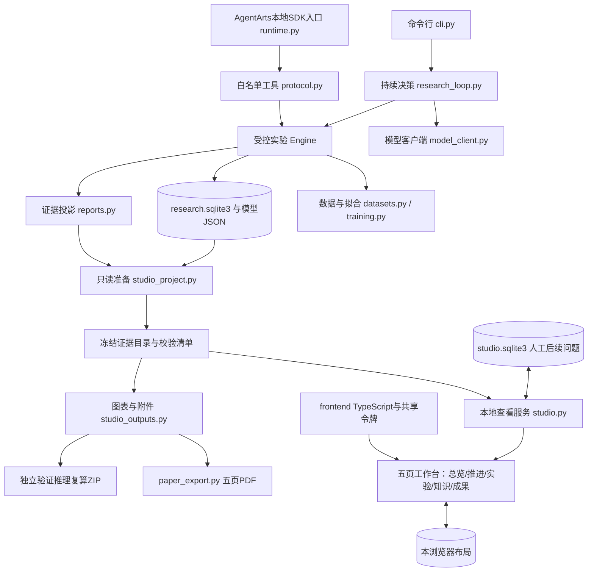
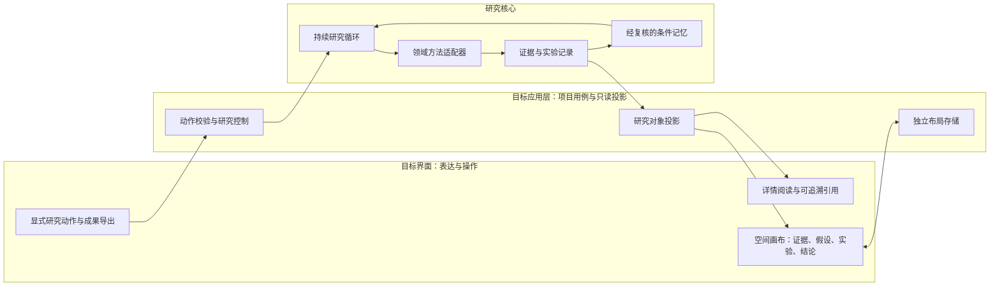

# 产品与架构

后端基线：R5本地提交 `e73bd7c`；R9在五页工作台加入可选的独立本地单步演示，不改变历史实验执行协议。下文区分现有代码与下一阶段设计；目标模块不作为已交付能力。

## 1. 产品主线

帮助科研团队把有依据的跨领域联系变成可检验的问题，持续选择并执行研究行动，根据真实反馈继续、修订或停止，最终形成论文式成果、可复核附件和带适用条件的研究记忆。

医疗、材料和软件工程共用研究契约。优先形成医疗×材料主案例；具体课题服从公开数据、专业方法及可获得反馈的条件。钢材回归是当前工程验证载体，尚未成为跨域科研主案例。

核心用户是正在推进一个研究项目的队员与老师。主要工作是理解“依据是什么、试过什么、为何采取下一行动”，而不是观察一群Agent的动画。

## 2. 当前实际结构

下图表示主要调用和证据传递路径，不是Python的逐条import图；各模块职责与代码入口见表。

`ReadOnlyEvidence`复用Engine的状态投影，通过只读SQLite连接读取原记录，不运行建表或迁移。准备阶段还使用保存参数重新计算验证预测并核对MSE。后续人工问题写入独立数据库，既有实验状态不随页面编辑改变。

| 层 | 当前职责与实际入口 | 当前边界 |
|---|---|---|
| 研究决策 | `ResearchLoop`记录请求、费用预留和动作，`ChatClient`发送有边界的HTTP请求 | 脚本端点流程通过；真实LLM研究效果未验收 |
| 实验控制 | `Engine`核对观察指纹、预算、幂等、采用门槛和终测锁 | 只允许固定数据与多项式/Ridge配方 |
| 领域计算 | `datasets.py`与`training.py` | 公开钢材与工程fixture；无医疗工具适配器 |
| 证据与成果 | `reports.py`、`studio_project.py`、`studio_outputs.py` | 冻结快照；五页模板最多5条钢材试验 |
| 研究界面 | `frontend/`、`studio.py`与生成的`web/` | 五个独立页面、研究流程画布、知识阅读、本浏览器布局、问题保存及原快照下载；可选本地脚本单步演示与原快照分离 |
| 平台边界 | `runtime.py`与`agentarts/` | 本地SDK HTTP已验证；云端部署、认证、存储、Trace待验收 |

可选 `--local-demo` 使用快照目录下独立的 `.local-demo-v1/` 账本和受控 Engine；接口只接受幂等请求编号，最多两次脚本选择的单步CPU拟合。来源快照SHA用于识别关联，不继承原模型或额度。显式触发前只读；未确认的在途任务阻塞新任务，不自动补跑。该演示不调用真实模型、外网或AgentArts，也不改写原快照、人工问题或PDF/ZIP。

C01 使用单独的领域分析脚本：`c01.py` 对指定原始包生成独立审计、两轮留一计算与记录；`c01_studio.py` 读取该记录及哈希匹配的原包，提供独立工作台、报告与复现包。可显式启用 `c01_loop.py` 创建独立账本，基于冻结输入执行两步确定性敏感性分析，记录观察指纹、依据、结果与停止理由；原快照、原报告与账本分开。它不伪装成钢材 Engine 的实验，也不继承其模型与预算。历史结果及后续分析都复用同一数据，不是独立验证；真实 LLM、领域复核和 AgentArts 平台仍需后续接入。

## 3. 事实归属与依赖方向

| 信息 | 权威来源 | 不应由谁覆盖 |
|---|---|---|
| 行动请求、累计预算与未知调用 | ResearchLoop持久账本 | 重启、前端或候选提案不能重置 |
| 实验结果、采用决定、终测 | Engine数据库及参数工件 | 白板拖动、报告润色、Agent预期不能改写 |
| 数据身份与评价设计 | 冻结的数据描述、协议和哈希 | 候选只能改变允许的实验配方 |
| 报告主张与来源 | 冻结状态投影和显式证据引用 | 不依据图形连线自行生成科学结论 |
| 人工后续问题 | 独立notes数据库 | 保存不等于已排程、已执行或已有结果 |
| 画布坐标与视口 | 按项目和快照隔离的本浏览器布局 | 不成为实验状态的事实来源；未实现跨设备同步 |

现有代码是一个Python包，尚未做物理分包。先按上述职责约束依赖；不要为整理目录而搬动全部模块、改写导入和重新设计持久格式。需要领域适配或新前端时，再按可验证的迁移逐步提取模块。

## 4. 目标结构：研究系统与空间界面

这是职责设计，不是当前目录树或服务部署图。应用层逐步复用现有ResearchLoop与Engine；首轮保持单体，避免先拆微服务。

研究团队按职责合作：协调者决定下一行动；证据角色收集来源与冲突；假设角色提出可检验预期；执行角色使用受控工具；评议角色核对结论和停止条件。可以由少量Agent按阶段承担多个职责，不为每个角色常驻一个进程。所有角色通过结构化记录交接，执行权仍归控制器，专业判断仍需相应证据或领域复核。

跨域联系须说明机制依据、适用条件与验证办法。文献联系本身不是研究收益；必须得到统计、仿真、优化或真实实验等适配反馈。负结果进入研究记录；只有经核对的结论才进入条件记忆。策略调整通过固定评价与版本比较决定是否采用，模型训练作为工具按数据与算力条件接入。

## 5. 下一阶段接口边界

- **读取研究对象**：从现有项目快照映射稳定对象ID与证据引用；不将整个数据库暴露给白板引擎。
- **保存布局**：当前浏览器按项目ID、快照身份、节点位置、视口与版本单独保存；不向研究状态写入坐标。服务端布局、自由分组和跨设备同步仍是目标接口。
- **采取研究行动**：通过独立命令入口核对目标、数据、权限、预算和幂等键。拖动、连线和保存草稿不触发模型或训练。当前仅有明确标识的独立本地脚本演示，尚无真实模型或平台的执行入口。
- **形成成果**：从核对后的研究状态生成同一份报告投影，画布、阅读模式、PDF和附件共享对象与引用身份。

后续将显式行动接到已有研究循环，并分别验证执行、数据和预算边界。真实模型及AgentArts恢复接入须遵守此前费用上限与调用前核查。云端集成、跨域研究价值与界面交互分别验收。
