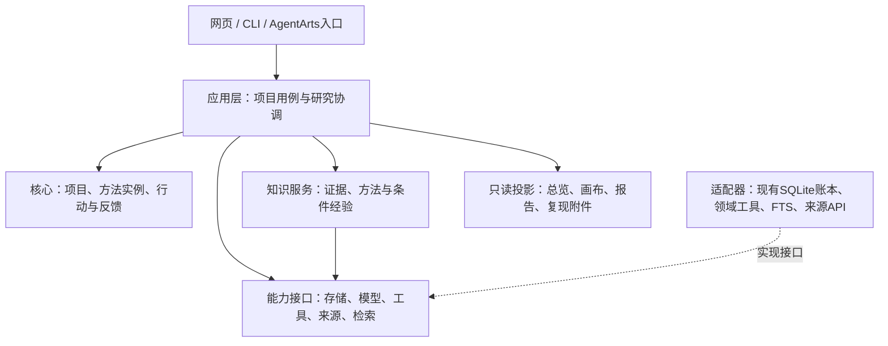

# 底层架构：职责、依赖与运行边界

## 架构需要承载什么

当前已有[显式跨项目方法案例](../project-experience.md)：复用条件记忆存储及方法卡，来源适配器核对保存Ridge OOF，再由目标项目版本化导入／撤回。独立`experience`供决策参考，不纳入当前证据、执行资格或预算；这部分已接线，通用跨领域经验学习与实际科研收益仍待验证。

研究者提交课题、材料和约束，系统围绕同一项目保存假设、执行与反馈；按实际条件选择方法，必要时改变下一步，输出可继续的项目和可复核报告。医疗、材料和软件工程通过不同方法及工具进入，不为每个案例复制一套系统。

先采用现有 Python 产品中的模块化单体；SQLite、现有工具和前端逐步适配。暂不增加微服务、消息集群或第二套前端框架。下图是目标职责，连线不代表已接通。

## 模块职责与依赖

| 层 | 负责 | 依赖边界 |
|---|---|---|
| 项目核心 | 项目/运行/行动身份，证据与结果关联，研究状态，方法实例 | 不导入浏览器、HTTP、供应商SDK或页面代码 |
| 应用用例 | 创建/读取项目，准备决策，执行行动，收集反馈，暂停恢复 | 调用核心和能力接口；不把案例字段写死在调度中 |
| 方法目录 | 方法版本、前提、输入绑定、评价与可选择后续检查 | 表达领域含义；实际运算由工具适配器完成 |
| 决策策略 | 从现有状态与适用方法中选择下一步，记录理由和预期反馈 | 可以调用模型；不能改写观测结果、预算或独立评价 |
| 知识服务 | 按当前决策查证据、说明、经验和不足 | 经来源/检索接口取资料，不自行批准科学结论 |
| 能力适配器 | 现有账本、工具、模型传输、文件/API来源、检索 | 实现能力接口；不反向决定产品目标 |
| 展示投影 | 将保存事实变成页面、画布和报告 | 读取项目/工件；布局与文案不能产生研究行动 |

## 一个项目，多个执行阶段

Project是长期研究容器；Run是一次带策略版本和预算视图的推进；Action是一次具体执行；Observation是实际返回的结果。模型解释、人工修订和候选采用另存，不能覆盖原观察。

项目状态与执行状态分开：某次Run完成，可以只是研究正在等待新资料。继续研究复用项目与累计预算，不通过新目录获得新额度。同步工具返回结果，异步工具返回执行身份并待收集；临时没有结果不能直接重发。

存储逻辑由一个项目仓储统管对象关联，较大的原件与工件留在资产存储，账本保存引用。现有专项账本和只读快照保留，通过适配读取；不对冻结历史做批量迁移。具体字段与恢复语义见研究契约。

## 条件自适应如何发生

1. 从项目取得问题、真实资产描述、已有观察及未决项。
2. 知识服务返回相关证据和方法说明；方法目录返回适用条件、缺口和候选。
3. 策略选择一个行动，并说明希望区分什么解释；不确定条件可先选择低成本检查。
4. 应用层绑定方法版本、输入、预算和请求身份，交执行器处理。
5. 保存真实反馈后重新准备决策；策略可以继续原方法、换方法、取证、等待或停止。

“按条件选择”由事实检查和模型判断共同完成。可确定的输入类型、工具可用性由程序检查；开放的科学解释交策略提出候选并保留不确定性，不把所有科研前提写成枚举闸门。

第一版策略θ只含 `next_check_priority: residual_first | source_first`，在两种方法都满足条件时决定先诊断残差还是先核对来源。输入身份、未知执行和终点资格先检查，偏好不能绕过这些条件；阅读深度、模型、工具、预算及失败处置保持固定。参数变化能否改善结果属于后续试验；任何配置都不能改写原始观察、研究目标或评价。具体触发与改选见自适应设计。

## 方法、Skill与Tool怎样连接

方法定义是一份可比较的研究设计；实例将它绑定到本项目数据、目标和评价。Skill可以提供方法操作说明，Tool执行一个运算/检索动作；方法目录保存两者的引用及实际可用性。

通用能力按“读取证据、比较解释、执行计算、收集反馈”等定位。具体方法保留测量终点、样本单位、处理规则和工具含义。跨域使用前需明确实体与条件怎样对应，不能因文本相似或字段同名就合并。

首个适配选已有保存 OOF 的 `residual_diagnostics.inspect_residuals(payload, dimension)`，先接同步本地算术，不复制专项模型循环。缺少的方法明确为不支持或待补条件，不生成成功结果。方法与工具分离后，可以替换实现而保留同一研究问题和结果关联。字段和两种方法实例见研究契约。

## 首个适配器的确定边界（A0）

|---|---|
| 实际入口 | [residual_diagnostics.py](../../src/autoresearch/residual_diagnostics.py) 的 `prepare_source`、`validate_source`、`inspect_residuals`；统一执行器只适配最后一个计算入口，来源准备另有显式动作 |
| 实际输入 | 停止且恰有一个完成候选的配置研究、精确绑定的发布快照、同键四规则的目标与基线/候选预测；`dimension` 仅 `topography` 或 `chemistry` |
| 实际输出 | `p02-residual-diagnostics-v1` 的完整 groups、rankings、rows 和有界 summary；观察保留每规则、方法、样本量、偏差和相对化学基线的 MAE 差，不只留摘要 |
| 资格与错误 | 先验证快照、候选、fold、材料键、覆盖和有限数值；不匹配不得调用计算。现有校验多用 `EVIDENCE_CHANGED`，适配时保存原错误并注明阶段，不声称已有完整通用错误分类 |
| 复用限制 | 这是 P02 专用工具：870 个共同材料键、35 折探索性 OOF、原始红通道代理值及四种处理规则；不外推为任意 CSV、ALP 终点或跨域通用残差工具 |

来源路径由宿主解析登记资产，工具不接受任意文件路径或代码。`prepare_source` 会读取旧账本并检查捕获期间未变化；A0 设计时只读定位，A4 直接登记已存在的封存 `source.json`，没有重建旧来源。

纯函数没有请求账本，也不会返回 pending。新应用层负责执行身份、预算预留、结果工件和幂等提交；已有 [DiagnosticStudy.apply](../../src/autoresearch/diagnostic_research.py) 的请求查重可以参考，其专用字段和工具顺序限制不成为通用契约。来源核对作为第二种设计实例，用于验证条件与反馈表达，不要求首个切片实现第二个执行器。

## 知识与外部数据流

来源连接器按需search/fetch，保存原始ID、URL、版本、许可与取得范围；解析后分流：文献片段进入检索，表格/图像/模型进入分析资产。共同来源身份连接两路，不把数据只转成文字。

知识服务在问题澄清、方法选择、执行准备和反馈解释四处使用。当前FTS与原文定位先复用；向量检索和重排作为可替换检索适配器，依据实际检索问题决定引入。科研证据、方法经验、平台开发文档分区，查询按用途选择。

历史经验保留适用条件和状态；检索命中不能直接变成confirmed事实。条件改变时可重新检查旧失败路线。首批外部connector候选及来源链接见自适应设计，当前尚未接通。

## AgentArts放在哪里

AgentArts是最终实际编排/运行入口；网页、CLI与平台使用同一项目应用接口和预算身份。研究状态及工件关联由产品核心维护，平台工作流中的模型决策、工具调用与反馈绑定同一项目。

一个项目在同一时刻只由一个执行驱动推进；本地驱动与平台工作流不嵌套各自的无限循环。切换驱动先读取保存状态与未决执行，不能重置请求。平台恢复后须验证真实往返、鉴权、持久化与费用，不能用包装调用或旧代码节点替代。

## 现有代码怎样复用

| 目标能力 | 已有入口 | 第一轮适配边界 |
|---|---|---|
| 请求持久化与恢复 | `C01LocalLoop`、现有专项控制器 | 提取可复用行为，保留未知发送，不照搬案例协议为通用字段 |
| 研究行动与计算 | `C01Research`、`ConfiguredStudy`、诊断工具 | 选一项真实工具，输入/输出经适配器保留原义 |
| 来源与检索 | `KnowledgeIndex`、来源提取和阅读工具 | 接知识服务，不更换整套索引平台 |
| 条件经验 | `ResearchMemory`及现有上下文adapter | 保留来源范围与状态，另验证跨任务作用 |
| 画布和报告 | 当前P02前端、快照viewer、dossier | 复用已认可展示，未来增加活动项目投影；不改旧快照 |

文件与正式说明见[后端索引](../../.agent/indexes/backend.md)、[接口索引](../../.agent/indexes/interfaces.md)、[组件索引](../../.agent/indexes/components.md)。现有类有案例约束，表中不是已完成的通用封装清单。

## 四条设计路径的整合（A3）

以下为设计推演，使用既有案例条件说明数据流，不是新增执行结果：

| 路径 | 选择与数据流 | 应保存的区别 |
|---|---|---|
| 正常取得结果 | 方法绑定来源/输入→工具执行→观察入账→策略读取结果选择下一检查 | 实际结果与解释分别记录，报告读取相同工件 |
| 结果反对原方案 | 比较未改善→保存有效负结果→选择误差诊断或另一解释 | 数值负结果不是工具失败，不凭换指标宣布成功 |
| 科学条件缺失 | 终点身份未知→保留核心问题→选择映射取证或范围明确的代理值子问题 | 不能将子问题结果升级为原生物终点结论；取得新资料后重新检查资格 |
| 执行中断 | 恢复先读取请求/操作身份→已有结果只提交一次，pending继续收集，unknown保留待核对 | 不重发未知请求、不新建预算、不把Run结束写成研究已完成 |

两份专项设计使用同一组对象与命令：`methods.match` 查询条件，`methods.bind` 只构造实例，`actions.submit` 接受并登记执行。知识查询只读已归档证据；获取新来源或调用模型必须另记 command。正常与反证路径均可产生 completed 的工具结果，解释与后续选择另存；缺条件可转 waiting；pending/unknown 由执行账本管理，不伪装成数值结果。详细状态表以研究契约为准。

### 本基线已确定与后续选择

| 已确定，可据此拆实现 | 留给实现或真实试点，不阻塞本设计基线 |
|---|---|
| Python 模块化单体；核心/应用/端口/适配器依赖方向 | 新模块具体文件划分和存储表结构，按首个切片最少增加 |
| 一个项目统管来源、累计预算与执行驱动；历史库只读适配 | 历史来源包怎样分发给没有本机 runs 的队员 |
| 首个真实工具为保存 OOF 的分组残差诊断 | 首个新来源 connector 的实际访问/许可与适配顺序 |
| θ 只改变两个合资格检查的顺序；目标、数据和评价固定 | 哪种顺序产生真实收益，以及是否值得进一步优化 |
| 数值诊断和来源核对保持各自终点、样本及比较语义 | 两个非 P02 真实任务的材料、反馈和领域评价人 |
| 网页/CLI/AgentArts 共用应用命令，平台暂缓 | HTTP 传输与平台恢复后的鉴权、真实往返及费用验收 |

未决项没有被默认填成已支持资源或已实现能力。当前基线足以拆出下面一个实现任务，外部科学取证仍独立待办。

## 首个实现任务（A4，本地切片已实现）

| 顺序 | 需要实现的最小行为 | 完成证据 |
|---|---|---|
| 1 | 把本机已登记 `source.json` 作为不可变资产接入新项目，保留上游来源与历史预算归属；不修改原账本 | 项目可读回来源版本、范围与累计预算，缺运行包明确报缺条件 |
| 2 | 目录仅登记此工具和代理值诊断方法；条件检查后用 request_id 接受一次 `inspect_residuals` | 真实既存数据产生完整诊断工件及 Observation，保存代码/来源/请求身份；新增拟合 0 |
| 3 | 固定策略读取实际分组反馈，记录下一项来源核对或尚未执行的合资格检查及理由 | 下一决定引用实际 action/observation，不把计划当执行；没有来源执行器时形成取证待办或 waiting |
| 4 | 重开同项目，同 ID 同内容返回原结果；同 ID 不同内容冲突；已保存结果在未完成提交处恢复 | 工具调用计数不增加、工件身份不变、累计预算不重置；unknown 只核对、不自动重发 |

应用层持有写入责任，适配器只读源数据并返回工具结果。执行前持久化身份与预留，结果先形成可核验工件，再提交观察；进程在两者之间退出可接续提交。若连执行是否发生都无法确定，保留 unknown；后续是否允许验证后重新做纯计算，须另明确规则，首个切片不暗中重算。

必要验证围绕上述一条真实本地路径：首次执行→反馈决定→跨进程重开→重复请求/内容冲突，以及同一执行在“已保存结果未提交”与 unknown 两种断点的恢复。A4 已完成这些限定验证；它们证明接线与恢复，不证明科学判断或策略收益。unknown 没有自动或人工放行重算接口，外部来源核对仍为待办。
