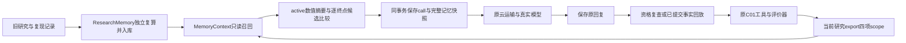

# 真实云研究的条件记忆与候选比较

本模块将既有 `ResearchMemory` / `MemoryContext` 接到真实Ollama云模型控制器。历史记录可以影响下一次选择，原始数值、适用条件和资格仍由原模块核验。工程回归、真实模型使用和科学判断质量分别验收；当前轮真实结果见文末。

## 数据和证据路径



四项scope是原包SHA、解析输入SHA、分析代码SHA和评价协议。它来自当前研究export；云控制器代码epoch不是分析代码SHA，不能拿它替换。任一不匹配均空召回，不做相似匹配或自动版本等价迁移。

只召回active `fit_observation`、`diagnostic_observation`。拟合观察只含配方、指标、领域警告和未独立终测状态；不含假设、预期改善或fit理由。暂停理由虽可作为 `agent_decision` 归档，本上下文不注入它。所有记录仍为 `derived_not_scientifically_reviewed`。

候选比较包含召回摘要及本研究已经执行的拟合，逐终点计算最低MAE、所有并列记录、末次当前配方及是否回退，并列出非支配集合。不同单位的误差不平均，不生成总分或下一配方。`memory:<记忆ID>` / `current:<行动ID>`仅是摘要定位标识，不能作为工具证据ID；原配方和指标保留在记忆entries或当前actions中。最多8项召回、摘要省略量和“非完整项目历史”明确记录，不能称全项目最优。

## 运行

先导入已完成研究的公开数值记录，导入过程会独立复算：

```powershell
.venv/Scripts/python.exe -B scripts/research_memory.py import --workspace runs/my-memory --research runs/previous-export/research.json --reproduction runs/previous-export/reproduction.json
```

新研究首次显式选择记忆库。原Ollama身份、费用检查和工具profile继续适用：

```powershell
.venv/Scripts/python.exe -B scripts/run_cloud_research.py --workspace runs/new-study --output runs/new-process-1 --memory-workspace runs/my-memory --archive PATH_TO_PUBLIC_ARCHIVE --index PATH_TO_FROZEN_INDEX --goal "实际研究目标" --model-store D:/ollma --max-requests 8 --max-new-requests 3
.venv/Scripts/python.exe -B scripts/run_cloud_research.py --workspace runs/new-study --output runs/new-process-2 --model-store D:/ollma --max-new-requests 3
.venv/Scripts/python.exe -B scripts/run_cloud_research.py --workspace runs/new-study --output runs/offline-check --max-new-requests 0
```

续跑省略记忆路径时恢复冻结mode；显式换路径拒绝。普通云研究不能临时加记忆，需另建研究。该参数由操作者选择，模型不能打开任意库。`--max-new-requests 0`仅离线消费已收响应及读取状态，不启动云服务。上面的占位路径须替换为已有资料，命令不是新的收费或平台开通授权。

## 快照、资格与恢复

`cloud-model.sqlite`新增 `cloud_memory_uses` 表。完整snapshot、实际发送projection及SHA与call预留在同一事务提交；写入失败一并回滚，尚未发送模型请求。完整快照限512KiB、projection限12KiB，最终请求仍限64KiB。超过上限在预留前拒绝，不自动减掉数值或放宽费用。

为给历史上下文留空间，仅记忆mode把数据检查中重复的source/sheet字符串编码为列字典。`provenance_table.encoding_schema=c01-cell-provenance-dictionary-v1`，`dictionary_encoded_columns`给出每列查表数组；对应整数是该列零起始索引。其余raw/formula/cell/样本值及64行完整保留，重复编码不会丢掉字典。原观察、原结果和SHA不改，实际请求必须按字典逐值重建检查；这是无损投影，不是更换数据。

| 状态 | 行为 |
|---|---|
| 新请求尚未预留 | 当前active快照与待发内容不一致则回滚，不计新增推理 |
| 推理发送结果未知 | 保留sending与完整快照，禁止自动重发或退款 |
| 回复已收、工具未提交，资格已变 | 原回复保留，call记为invalid；下一请求重新读取active记录 |
| 回复已收、工具未提交，记忆库缺失/损坏/替换 | 保留received并停止应用，不新发推理 |
| 工具已提交、控制器尚未登记 | 验证原收据后按原request ID回放，即使记忆随后被撤回或移除，也不重复拟合或抹去事实 |

快照只说明读取时的资格；两个SQLite库与HTTP间没有全局原子撤回租约。工具提交前会核查相关快照，不能撤回已经发送的消息或保证感知读取之后的每一次变化。原始模型回复不补参，记忆不释放财务hold，也不改变当前引用和动作校验。

## 验证边界

脚本测试覆盖原子预留、撤回、缺失/替换、快照篡改、未知发送、提交后恢复、CLI冻结mode、大小上限及多终点并列/回退。这些测试不是真实LLM策略增益。真实试验还需逐项核对保存body里的记忆、候选数值、模型下一行动、独立复算、账户差额和自有进程关闭。

AgentArts接入、8B下载和付费调用继续暂停；原5元现金结算仍未知。已有免费包含额度须逐次检查，记忆mode不改变旧费用边界。
