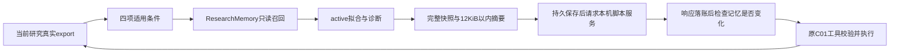

# 用条件记忆推进下一项实验

`C01MemoryLoop`把匹配当前输入与评价器的历史数值观察送入下一步决策，并保存当时实际使用的内容。原`C01ModelLoop`、C01计算与评价协议保持原字节身份。这是可选的本机脚本服务模式；真实LLM策略改善、AgentArts编排、科学增益均未验收。

## 数据怎样流转



每次最多召回8项active拟合或诊断；`agent_decision`停止判断不注入。摘要保留四个终点指标、配方、诊断数字、未科学评审状态、来源版本与省略数量。历史动作ID仅作溯源，不能代替当前研究已经取得的引用或实验依据。旧观察是可参考数据，不是禁止某方向的科学定律。

## 配置与恢复

先按[C01研究入口](c01-research.md)建立一个新study，再配置独立记忆库。库必须已存在，普通单链接SQLite文件及父路径不能重定向。适用范围、物理文件身份和adapter源码身份冻结；正常追加版本、撤回和恢复会改变内容但不因此拒绝文件。已开始发请求的普通执行器不能临时改成记忆模式。

```powershell
.venv/Scripts/python.exe scripts/c01_memory_loop.py configure --workspace runs/new-study --memory-workspace runs/my-memory --config runs/fixture-config.json --max-requests 8 --max-cost-cny 5
.venv/Scripts/python.exe scripts/c01_memory_loop.py run --workspace runs/new-study --max-new-requests 2
.venv/Scripts/python.exe scripts/c01_memory_loop.py run --workspace runs/new-study --max-new-requests 6
.venv/Scripts/python.exe scripts/c01_memory_loop.py status --workspace runs/new-study
```

测试配置与服务生命周期见[C01持续执行器](c01-model-loop.md)。只接受literal loopback及专用非秘密fixture token；`--allow-live`不启用供应商端点。5元在此是模拟费用上限，不是团队剩余额度或真实开通授权。

记忆模式研究应始终由此CLI续跑。旧CLI仍可读取原有研究；直接换成其他Python执行入口不在本adapter的约束范围内。这是明确选用的运行协议，不是防止本机操作者改程序的安全隔离。

| 中断或变化 | 行为 |
|---|---|
| 尚未发出新请求 | 重新读取当前active资格，验证完整请求字节上限，再预留 |
| HTTP前 | 先保存原观察、消息、预留，再保存完整记忆快照与实际摘要；两次提交之间中断保留sending未知态，不自动重发或退款 |
| 响应已保存但工具未提交 | 沿用原消息；相关召回快照改变则将旧响应记invalid，保留请求与费用；库缺失或损坏则暂停应用 |
| 工具已提交但执行器尚未登记 | 按原请求ID回放已提交动作，即使之后撤回了记忆，也不重拟合或抹去实际执行事实 |
| 记忆文件被替换 | 新读取拒绝，既有请求和动作仍保留 |

adapter响应消费由本机操作系统文件锁串行化，进程退出后内核释放，留下的锁文件不是待人工清除的租约。标记invalid的写事务内还会复查真实动作，避免把检查期间已经提交的结果误记为未执行。其他入口直接调用Python工具不受这把协作锁约束，记忆模式应始终使用本adapter。

快照记录一次一致读取。两个SQLite库和网络之间没有全局原子撤回，不能撤回已经发出的消息，也不保证读完到工具提交之间立刻感知每次资格变化。已提交结果不会因随后撤回而消失；后续研究重新读取资格。

原始观察哈希不变。`c01_memory_uses`另存完整快照和发送摘要及各自SHA；12KiB只约束摘要，完整快照另有512KiB上限，最终HTTP请求还受原客户端上限约束。哈希说明内容一致，不证明源材料真实或模型身份可信。

## 如何验证机制

`scripts/evaluate_c01_memory.py`使用同一公开8合金输入、原资料索引与评价器，四个独立研究各运行一项配方和两项诊断。共同策略明确由脚本写定：从alpha=1、100中挑选尚未出现在收到的active拟合记忆里的第一项；其他步骤沿用原fixture的实际反馈。

| 条件 | 预期alpha | 对照含义 |
|---|---:|---|
| 无记忆 | 1 | 重做注册历史中已有配方 |
| active且条件匹配 | 100 | 同一预算改为未尝试配方 |
| 已撤回拟合、诊断仍active | 1 | 不使用已撤回的配方观察 |
| 旧评价器不匹配 | 1 | 空召回，不降低匹配标准 |

设计复用已有`ResearchMemory.recall`、SQLite和父执行器的预留/消费/幂等逻辑。已归档的[LLM-AutoSciLab固定版本](https://github.com/scientific-discovery/LLM-AutoSciLab/tree/467fa184ba537d26b2228ee3f3a8c052d9bfca58)仅供负证据组织方式参考；没有运行其程序或照搬其提示词权限。StateMem的[状态修订基准](https://arxiv.org/abs/2608.19652)也不能代替本项目的科学验证。
