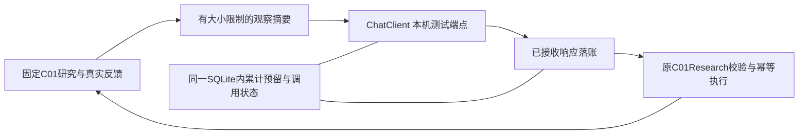

# C01持续执行器

这一层让产品执行“读取反馈 → 请求下一项决定 → 校验 → 执行工具 → 落账”，复用已经跑过的C01研究工具。研究目标、原始输入、评价器和累计额度保持固定，每一步的配方、资料查询与停止理由可以调整。

本版本只接受本机loopback测试服务，明确拒绝真实供应商端点。测试服务是脚本，不是大模型；它能验证执行协议、真实工具计算和中断恢复，不能验证模型的科研决策质量。真实模型调用、AgentArts接入、科学独立验证和LLM权重训练均未完成。原有共享5元额度及平台暂缓状态继续有效，虚拟费用不代表剩余真实额度。



## 执行与恢复边界

每次网络请求先持久保存观察身份、消息、请求ID与保守预留额，再发HTTP。未知的`sending`状态不会自动重发或退款；先保留并复核。已保存的`received`响应可重新应用，沿用原请求ID；工具已提交而执行器尚未登记成功时，由原C01幂等逻辑返回旧结果。

无效JSON、未知字段、伪造引用、旧观察、重复配方不能触发额外实验。已经接收的无效模型响应仍消耗请求次数；没有可信用量的网络失败保留完整虚拟预留额。步数用尽、模型请求上限、研究动作上限和拟合上限分别记录，不因重启重新计算额度。

模型看到的是明确标注的摘要，保留原完整观察哈希、来源与动作ID、逐终点指标及限制，省略逐折预测矩阵等大对象。完整原始结果仍保存在研究账本。摘要命中和数值反馈不使文献内容成为指令，也不授予执行代码、变更标签或修改评价器的权限。

## 运行入口

在已安装项目依赖的产品根，先运行协议测试：

```powershell
.venv/Scripts/python.exe -B -m unittest discover -s tests -p test_c01_model_loop.py -v
.venv/Scripts/python.exe scripts/c01_model_loop.py --help
```

测试自带明确的合成输入和本机HTTP服务，不需要真实密钥，也不访问云平台。独立真实输入验收另外执行，不能把合成测试当作数据科学结果。

复用API时，先按[C01研究入口](c01-research.md)创建新的study，再使用`C01ModelLoop(workspace).configure(config, max_requests=8, max_cost_cny='5')`冻结配置。`scripts/c01_model_fixture.py`提供`model_fixture()`上下文及`configuration(endpoint)`；服务上下文必须在整个测试期间保持运行。只设置`C01_MODEL_FIXTURE_KEY`为该脚本内的非秘密fixture token，不复制真实供应商密钥。价格和用量字段是模拟记账。

CLI的`configure --config FILE`、`run --max-new-requests N`、`status`、`reconcile --call-id ID --confirm-worker-stopped`均要求`--workspace DIR`。首次配置后，`run`从数据库读取冻结配置；更换连接或提高累计额度被拒。单次最多8项新请求，总计最多24项。单次步限到达仍可接着`run`，累计次数不清零。`--allow-live`不能解除真实端点禁用。

`received`无需密钥也能恢复；`sending`要求先确认旧进程已停止。人工确认只把未知项保留为失败项，不退回请求次数或预留额；不能仅为清掉错误而确认仍在运行的进程。
