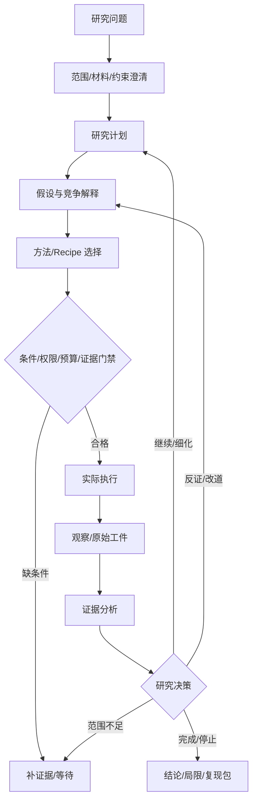

# Research Lifecycle

## 流程

## 核心实体
- Project：长期课题及累计资源。
- Research Cycle：一轮研究推进。
- Plan / Plan Revision：研究路线及其变更历史。
- Hypothesis：可检验主张、竞争解释、状态和证据。
- Recipe：方法适用条件、输入、步骤、评价和分支。
- Method Instance：绑定当前数据、目标、评价和参数的方法实例。
- Action：一次模型、工具、人工或外部行动。
- Observation：真实返回结果，不等同于解释。
- Evidence：原文、数据、计算、日志、评审材料。
- Interpretation：模型/研究者对观察的解释，保留不确定性。
- Decision：继续、改道、补证据、等待、停止的理由。
- Experience：带来源、范围和条件的跨项目经验。
- Artifact：原始输入、脚本、环境、日志、图表、报告和复现包。

## 每个计划步骤必须包含
`step_id / question_to_resolve / why_now / method_ref / required_materials / eligibility_conditions / expected_observations / decision_branches / budget_estimate / limitations / completion_criteria`

## 决策类型
`continue / refine / branch / change_method / request_evidence / wait / stop / complete_with_limitations`

## 报告结构
问题与范围；来源和数据身份；计划及修订历史；假设；方法选择及适用条件；执行记录；证据；支持/反驳/不确定性；失败路线；结论范围；未决事项；下一轮计划；复现附件。
