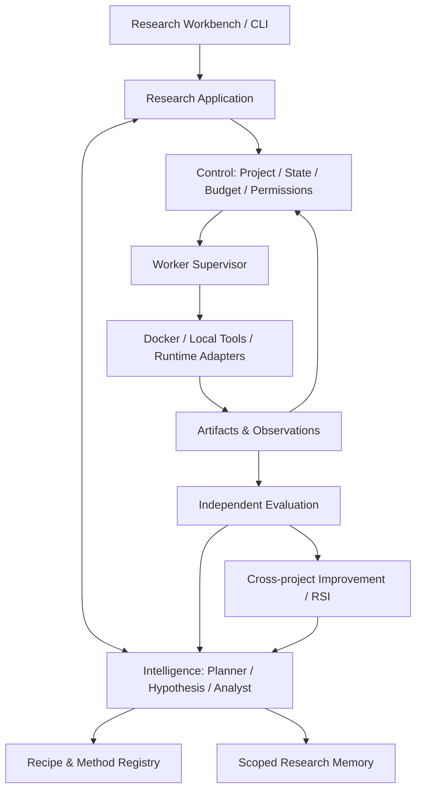

# Reference Architecture

## 架构定位
以研究工作台为中心，采用逻辑分层，不急于微服务化。保留现有 Python 模块化单体、SQLite、TypeScript/X6；执行由独立 Worker + Docker Sandbox 承担。

## Control
权威 Project/Run/Action/Observation、累计预算、请求身份、幂等、恢复、权限、审批和审计。模型不得直接写事实源。

## Intelligence
Planner、Hypothesis、Method Selector、Evidence Analyst、Plan Reviewer、Memory Retriever、Meta Research。只输出结构化 Proposal。

## Execution
Worker Supervisor、Docker、Python/RAG/ML/Coding/Source adapters。执行返回工件和观察，不决定科学结论。

## Evidence
SQLite 元数据 + 文件/对象工件 + Git 代码版本。记录 dataset/code/evaluator/recipe/prompt hash。

## Agent 模式动态选择
Sectioning、Orchestrator-Workers、Competition、Evaluator-Optimizer、Review、Sequential。根据依赖、独立性、风险、成本、并发资源选择，不固定启动全部 Agent。

## 现有仓库优先复用
ResearchProject、ProjectController、research_loop.py、research_memory.py、recipe_improvement.py、method_registry.py、research_recipe.py、source_evidence_adapter.py、runtime.py、protocol.py、现有工作台和报告。先审计实现，不因文档存在就判定已完成。

## Worker
本地独立进程 + Docker；未来远程 Worker 使用相同协议。默认网络关闭，非 root，CPU/RAM/PID/磁盘/时间限制，临时工作目录，凭据不注入不可信容器。当前机器只有 4 核/16 GiB/约 30 GB 空闲/无 GPU，重型 Worker 初始并发 1。

## Runtime
OpenHands SDK 可作为 Coding Worker 候选；Codex/Claude CLI 通过 Adapter；LangGraph 仅局部编排 PoC，不接管项目、证据和预算事实源。最终按实测决定。

## 可观测性
统一 project_id/cycle_id/action_id/task_id/agent_id/worker_id/model/runtime/recipe/prompt/strategy version、artifact refs、dataset/code/evaluator hashes、cost/tokens/duration/retry/recovery。
