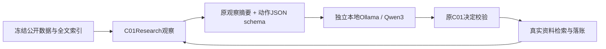

# 真实模型接管与持续运行

真实模型入口与原有脚本测试服务分开，分别记录本地Qwen权重和已有Ollama云模型的身份、实际调用及恢复证据。脚本响应不能充当真实模型研究；已有登录由官方程序自行使用，代码不读取密钥内容。共享5元现金费用账尚未核清，付费调用继续暂停；已有免费包含额度仍需逐次检查。

## 复用结构



## 模型身份

使用已安装的 Ollama 0.40.11。官方模型为约2.5GB的Q4_K_M、Apache-2.0权重，校验全部引用blob的大小与SHA-256后运行。

| 身份 | SHA-256 |
|---|---|
| 发布方清单／native API digest | `359d7dd4bcdab3d86b87d73ac27966f4dbb9f5efdfcc75d34a8764a09474fae7` |
| 本地来源包装清单 | `31d9857b5705086d352d4d6db04e86c5d0f6a2b5d59a4dc7ce5cdb271ccf9141` |
| GGUF模型blob | `3e4cb14174460404e7a233e531675303b2fbf7749c02f91864fe311ab6344e4f` |

新版Ollama在本地增加来源清单层，两种清单身份都保留，不能互相替代。校验还要求包装中的模型、模板、参数和配置与发布方清单完全对应。

## 运行和失败边界

在产品根、已有虚拟环境中：

```powershell
.venv/Scripts/python.exe -B scripts/probe_local_research.py --help
.venv/Scripts/python.exe -B scripts/probe_local_research.py prepare --cache runs/local-model-cache --output runs/new-model-preparation
```

`prepare`只准备和核验权重，零次推理；`probe`还必须提供 `--archive` 与 `--index`。输出目录必须是新的；模型缓存可复用。每次推理最多512个输出token、4096上下文、180秒，整个进程关闭后端口释放。下载和本地运行有网络、磁盘与电力消耗，但未调用付费推理API。

请求一旦进入发送状态，超时或中断都不能推定“没有执行”。保存未知记录，不自动重发；已接收但未通过契约的内容保留为失败证据，不据此编造成功结果。模型权重、运行程序和响应token证据共同支持实际本地推理；单独存在缓存或loopback响应不够。

两次准备阶段失败也保留：首次错误地把本地包装清单与发布方清单直接比较；第二次错误地拿native API digest对比本地包装文件。两次均未发chat。首次启动采用默认用户资料环境，是否初始化了默认目录中的本机key尚未核实，不能追认为隔离成功；没有读取或删除默认目录key。后续已改为独立资料目录并完成实际关闭验证。

## 持续循环的接线

`c01_local_loop.py`将真实模型接入原研究工具，`run_local_research.py`负责拥有本地进程。它们不解除原fixture执行器的端点限制，也不套用虚拟费用。每项研究最多8次累计native chat、每次768输出token、8192上下文、180秒；重启不能提高上限或更换模型、研究输入和控制器版本。

模型可以检索、选择Ridge正则强度与特征、诊断误差或关联，以及暂停／停止。schema只约束权限、字段、当前有效ID和数值范围；不会指定查询、配方、预期结果或停止理由。无效响应消耗一次请求，保留原内容，下次看到错误反馈；未知发送结果阻止继续。科学上可以提前停止，不要求为了凑流程而拟合。

`research.sqlite`仍是研究动作与数值的权威账本；`local-model.sqlite`单独保存原始请求、完整观察、原生响应、SHA和累计调用。消费者在后者的短事务中串行执行原研究工具，网络不占写事务。若工具已提交而模型账本尚未登记，重启后用同一request ID恢复，原工具返回已有结果，不重复拟合。SQLite事务不能证明外部发送未送达，因此 `sending` 不会自动重发。

新研究首次运行需要 `--workspace`、`--archive`、`--index`、`--goal`，另给新的 `--output` 进程证据目录和可复用 `--cache`。后续保持同一workspace和累计上限，只更换output；`--max-new-requests`控制本次分段次数。`--max-new-requests 0`只恢复已接收响应与读取状态，不发推理。终止后再次运行不启动模型。不要把旧研究直接改造或覆盖成新模型试验。

实现参考 [Ollama结构化输出](https://docs.ollama.com/capabilities/structured-outputs)、[SQLite事务](https://www.sqlite.org/lang_transaction.html) 和已归档 [autoresearch研究循环](https://github.com/karpathy/autoresearch/blob/228791fb499afffb54b46200aca536f79142f117/program.md)。复用的是原评价器、来源契约与持久工具；本项目增加带来源及测量条件的研究反馈，保留失败和停止决定。实际运行结果与接口测试分别记录，不把它们合计成新增独立样本。

## 固定实验协议与重复检索控制

模型上下文显示已执行检索参数、每次新增引用数及最多4段480字符的原摘录摘要。来源片段较多不等于科学依据更强，新增引用数也不是研究效果分数。

同查询文本（大小写／空白等价）、同kind集合、同limit的已执行检索会得到`DUPLICATE_SEARCH`：模型请求仍计数，原内容保留，工具不重复执行；下一次看到错误反馈。该比较键只用于重复判断，不替换原请求、观察、来源或控制器的SHA身份。提高limit可以合法扩大检索，不能仅因query相同便判为纯重复。

最后一个模型请求位置只提供pause／stop，收到的action还须属于该次已保存schema。它是预算约束下的模型控制决定，不能当作模型独立发现了科学停止条件。恢复已接收响应使用当时保存的schema与观察；工具已提交时保持幂等，不按当前剩余额度重新解释旧请求。
