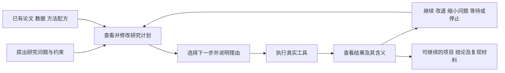

# Auto Research 产品概念与推进主线

更新于2026-11-09。产品定位、当前能力与下一阶段分工，供团队开发和准备演示使用。外部研究与产品比较沿用11月6日阅读记录。

本月具体交付范围、演示故事与阶段完成标准见[11月30日提交计划](submission-plan-20261130.md)。当前竞品工作流、能力取舍及平台首接路径见[产品横向调研](product-landscape-20261106.md)。

**Auto Research 围绕一个持续的研究问题，帮助研究者组织资料与方法、形成可修改的研究计划、执行真实工具，并根据结果调整下一步。主要交付物是可以继续工作的研究项目，以及有依据的结论、被放弃的路线和未决问题。**

当前已经实现可修改的计划、模型建议及采用、总览中的当前进度与下一步，以及研究者意见的保存和展示。公开diabetes项目已完成质量检查、描述性关联分析、反馈后的计划修订、来源读取和报告。A64四行构造工程样例完成配方修改、验证、明确采用及有效v2的后续分组画像。有界保存证据队列也已合并。AgentArts唯一真实回答已采用为独立工程项目的计划v1，并接入完整五页工作台和画布，后续行动、报告与平台视频待收尾。整体产品仍需补同一真实课题的连贯多轮推进、两位真人完整使用及交接证据。

## 1 产品服务谁，帮助完成什么工作

长期方向保留材料、生物医学、软件工程及有实际问题联系的交叉研究。近阶段建议优先服务已有明确课题、论文或本地数据的学生与小型研究团队，先解决日常推进与协作的困难。这是实现顺序的选择；这些用户是否愿意持续采用，仍需真实使用反馈。

近期重点场景为数据支持的探索性研究。研究者带入可用表格数据和相关资料，提出一项可检验的问题，完成必要分析，检查结果的依据和适用范围，再决定下一步。当前已有质量、分组、关联和来源核对能力，新增方法按同一真实课题的具体问题选择。

他们需要完成的工作包括：把宽泛问题缩小到能检验的一步；从几种合理方法中选一条路线；实际完成分析或资料核对；遇到反证时知道该改什么；中断或换人后能够继续；向老师或合作者解释结论是怎样形成的。产品应围绕这些工作组织页面和输出。

一次成功使用可以只解决一个重要未知，也可以排除一条路线，或者形成一份计算与证据都可核对的结果。研究价值取决于它怎样改变后续判断。文件相同、接口成功、程序可恢复，主要说明执行是否可靠。

## 2 统一几个经常混用的概念

| 概念 | 在本产品中的建议含义 | 一个具体例子 |
|---|---|---|
| 研究项目 | 长期问题、资料、假设、计划、实际结果及协作上下文的归属 | 判断一种材料特征是否有助于预测某项已明确的性能 |
| 研究问题与假设 | 要判断什么，以及什么观察会支持、缩小或推翻当前解释 | 模型优势是否来自材料特征，还是来自相近样本同时进入训练和验证 |
| 研究配方 | 可复用的方法设计：说明适用条件、所需材料、采用的方法、评价方式和反馈分支 | 检查预测优势是否依赖数据划分；有批次信息时怎样处理，没有时能判断到哪里 |
| 研究计划 | 某个项目此刻采用的路线，将配方绑定到实际资料和当前问题，可由研究者或Agent修订 | 先核对现有划分，再比较已有结果；若发现相近样本交叉，优先重新设计评价 |
| Tool | 一项实际能力，返回计算、检索或外部操作的结果 | 读取工作表、计算分组误差、检索论文 |
| Skill | 操作方法或工具的说明，可作为方法知识的一部分 | 如何准备某项分析、怎样识别常见失败 |
| Agent | 综合目标、证据、方法与约束，提出计划、选择行动、解释反馈 | 说明为何此时先检查划分，并在结果返回后修订计划 |
| 执行协调 | 把允许的行动真正交给工具，保存执行身份、结果与资源消耗 | 一项分析中断后沿原行动继续，避免重复执行 |
| 研究经验 | 带适用条件和出处的经验候选，供后续任务参考 | 某种随机划分曾高估相近材料上的预测效果，适用范围和反例一并保留 |

这些对象共同承担研究过程。当前已有[研究契约](../architecture/research-contracts.md)区分项目、方法、行动和观察；用户界面应优先呈现研究含义，技术身份和恢复细节按需展开。

### 配方需要比“先A后B”表达更多

现有两份正式JSON配方主要交换“先分组画像”与“先读已登记来源”的顺序，程序从合法候选中选一步，未匹配时等待。模型能提出配方修改候选，并通过显式允许的原工具取得验证结果。方法卡已可读取、校验及关联宿主候选，卡片条件保留未核验说明。单轮外环已消费A64原提案与验证，项目明确保存keep及有效v2，默认控制器按v2完成后续分组画像。现有范围见[方法卡设计](../recipe-research/recipe-design.md)、[实际编译代码](../../src/autoresearch/research_recipe.py)与[外环及后续行动记录](../recipe-research/rsi-delivery.md#a64有效v2的实际后续行动)。

目标中的研究配方还需回答这一步要区分哪些解释，适用和不适用的条件是什么，什么结果能改变后续行动，结果解释到什么范围。[方法设计说明](../architecture/foundation.md#方法skill与tool怎样连接)已有这个较完整的含义。方法卡已承载这些说明，下一阶段用真实研究任务检验其是否帮助选方法和解释结果，再按具体缺口调整。

配方可以只有一个有效检查，也可以有多个分支；成熟的固定方法也有价值。方法条件存在不确定性时，可以先做用途明确的探索性检查，或暂时缩小问题，避免把所有未知都变成开始工作的先决条件。

### 方法从哪里来，怎样成为可用配方

方法知识可以来自论文、领域成员已有流程和带出处的历史项目。第一步是整理成可读的候选：它在什么问题与条件下使用了什么方法，得到什么反馈，哪些地方仍依赖作者解释。Agent可以帮助提取和补全说明；团队决定是否采用，以及本次采用到什么范围。

一篇论文描述过某方法，只能证明这份方法说明有来源。已经接好某工具，说明它能够被调用。某个案例成功使用，说明该条件下取得了结果。这些事实共同帮助判断适用性，各自仍保留范围。方法候选逐步完善即可，不要求所有配方在进入目录前完成同等深度的科学验证。

组合配方时，应先明确前一步的输出能否满足后一步的输入，几步共同回答哪个问题，以及如何判断组合后的结果。共享标签或文字相似度可以提供线索，具体选择仍要说明依据。现阶段优先复用人能理解的方法设计；自动抽取与组合的收益需要后续观察。

研发Agent使用的开发Skill帮助编程与协作；科研运行中的配方和操作指南服务于课题，两者分别管理。

### 知识 证据与经验怎样参与决策

文献证据帮助判断已有主张和当前解释；方法知识帮助选择怎样研究；历史经验帮助识别在相似条件下值得尝试或避免的路线。页面可以把三者放在当前计划旁，但需要说明各自的用途。

在问题澄清时，资料帮助限定目标；在选方法时，方法说明帮助判断适用性；在结果返回后，证据和经验帮助解释是否值得改道。系统应能指出某条材料怎样影响了当前选择。检索命中和引用数量本身不说明它发挥了作用。

表格、图像、模型和代码还需要作为实际分析资产保留，不能只把它们的文字摘要交给模型。一次核对可以直接利用已捕获原件；开放的解释则保留模型判断与不确定性。[知识流设计](../architecture/foundation.md#知识与外部数据流)提供了这几个决策位置，后续产品应把它们呈现为能理解的研究动作。

### 跨领域与跨学科各指什么

多个领域共用项目、计划和执行框架，属于过程层的复用；具体方法保留其输入、单位、样本与评价含义。跨学科研究进一步要求说明不同领域的知识或数据怎样联系，并且这种联系改变了哪个研究问题或验证方案。

例如，将材料结构与细胞测量关联，需要能说明材料实体、测量对象和条件怎样对应。字段同名或几种工具在同一页面上出现，尚不足以建立这种联系。当前已有的多领域有限工具为统一过程提供了底座，更广泛的迁移与交叉研究仍是后续目标。

## 3 自适应与持续改进分别发生在哪里

产品中保留两条反馈链。课题内的调整连接本次结果与下一版计划。研究方法的改进连接具体反馈、配方修改、后轮表现与保留或回退决定。后续项目利用经验，是让已保存的做法带着适用条件进入新任务。

### 研究中的调整

同一项目取得新结果后，改变下一步的选择、顺序、问题范围或方法。例如：预测优势对划分很敏感，于是优先检查评价设计；原始数据支持不了效应判断，于是先完成限定范围的描述。这类变化应该能在计划上看见，并能说明它依赖哪条反馈。

### 后续项目利用经验

新项目参考过去的方法、失败和适用条件，减少重复摸索。经验可能不适用于新数据，也可能被新结果修订。Agent Workflow Memory展示了从操作经验提取工作流的思路，同时讨论了模板动作与环境不相关、何时应该偏离模板的困难。对本产品的启示是保留适用条件与改道空间。[AWM v1，§3.2.1与§5](https://arxiv.org/html/2409.07429v1)

### 系统自身的优化

对提示、选择策略或工作流进行修改，再检查是否改善了后续独立任务。AFlow在预设操作符构成的代码工作流空间中搜索；GEPA主要利用执行轨迹优化已有系统的文本模块。这些结果支持研究有边界的优化方法，不能直接证明我们的系统会因使用次数增加而持续变强。[AFlow v4](https://arxiv.org/html/2410.10762v4)、[GEPA v2](https://arxiv.org/html/2507.19457v2)

内层研究调整已有公开数据轨迹。外层单轮keep/revert模块、项目显式采用、有效版本和默认后续执行已接通。A64四行工程样例完成候选v2→验证→明确采用→按v2分组画像→反馈等待及报告，保留工程判据和实际工具结果。基于v2的新Host提案、真实任务科研收益和多轮自主持续改进仍待取得。

## 4 用户应该经历的一条完整主线

下图表示目标体验，当前实现范围见第7节。

用户提供问题和已有材料后，应先看到系统对问题的理解、当前能够判断的范围，以及一份简短计划。重要的假设由用户补充或修改；已有资料能够支持的工作直接进入计划，其他缺口按影响程度说明。

例如，队员带来一份实验数据和几篇论文，询问处理条件是否与测量结果有关、接下来值得研究什么。工作台应承载六个相连的动作。

1. 明确对象、比较指标、已有材料和关键缺口，让用户确认问题。
2. 给出计划，说明步骤、依据，以及不同结果会怎样改变路线。
3. 执行分析或资料读取，保存真实结果和出处。
4. 根据反馈调整计划，例如先处理批次可比性，或核对指标定义。
5. 在约定范围内继续，遇到缺资料、资源不足或需要人判断时保存停点。
6. 留下结论、依据、放弃的路线、未决问题与可复用的方法，供重开或换人后接续。

计划中的每个近期步骤应让人看懂三件事：为什么现在做、它要区分什么、得到不同结果后怎么办。研究者可以调整优先级、删除不相关步骤或限制资源；Agent应解释这对后续判断的影响。

连续推进可以在已经同意的任务和资源范围内进行。研究者只需在需要决定研究取舍、额外资源或重要外部操作时介入。页面应清楚显示当前正在做什么、最近结果改变了什么、下一步由谁推进。

中断或交接后，项目保留当时的问题、计划和实际反馈。报告从这些内容形成，并连接到相应依据。画布用于看清问题、路线和证据之间的关系；正文用于阅读与修改具体研究内容。

五页导航和画布共同服务于三个问题。现在知道了什么，为什么这样判断，下一步做什么。

## 5 一个体现“反馈改变计划”的设计示例

以下是目标用法，未新增执行或声称取得研究结果。

研究者提出：“现有材料特征加入后，模型的预测优势是否能推广到不同材料？”已有数据和保存的模型结果进入同一项目。

Agent提出首轮计划：先确认目标与现有划分方式，检查验证样本与训练样本的相似性，再判断是否值得开展新的模型比较。配方说明需要哪些输入、可采用哪些检查，以及缺少批次信息时结论应缩小到什么范围。

假如检查发现高相似样本同时出现在两侧，Agent应将原来的“继续尝试更复杂模型”改为“先调整评价设计”，引用实际检查结果，解释为什么旧优势不足以支持推广。研究者可以接受这次改动，也可以要求保留原比较并补充限定说明。

假如没有发现这种问题，Agent继续原计划或检查另一种解释。假如现有材料不足，系统列出可继续的限定工作，并将依赖额外材料的部分留待后续。等待中的某个案例可以保留原状态，其他项目和产品开发仍按各自目标推进。

这一例子把问题、方法依据、实际反馈和路线修订连接起来。一次试用首先要观察用户是否理解并采用这种连接；它尚不足以证明系统总体优于人工研究。

## 6 相近研究与产品给我们的启示

以下比较使用固定版本论文和官方说明，作为机制参照。完整来源、阅读范围和局限见[概念研究证据](product-concept-evidence.md)。

11月6日新增比较覆盖文献助手、通用Host、科研执行系统及平台。Elicit已经支持回改步骤，Perplexity可调整研究路线，Kosmos的2026产品说明包含持久编码Agent和交互反馈。可修改计划、长期项目与多Agent各自保留其具体作用，产品差异需要由实际研究体验支持。能力引进和优化按[本轮横向调研](product-landscape-20261106.md)推进。

| 一手先例 | 具体组织方式 | 对本产品的设计启示 |
|---|---|---|
| [LitPivot v1，§4.3](https://arxiv.org/html/2604.02600v1#S4.SS3) | 围绕正在编辑的研究想法，提供相关证据、批评与修订建议，研究者选择接受或拒绝 | 计划的一步应能直接连接依据和修改动作，反馈变化要在计划上看得见 |
| [Kosmos v2，§2.1](https://arxiv.org/html/2511.02824v2#S2.SS1) | 从目标和数据出发，交替开展文献与数据分析，将结果积累到持续的研究状态并关联出处 | 项目要保留当前理解、未决项和路线变化；先利用现有对象完成接续 |
| [Google AI co-scientist官方说明，2025-02-19](https://research.google/blog/accelerating-scientific-breakthroughs-with-an-ai-co-scientist) | 人提出目标和种子想法，系统生成与反思假设，并接收科学家的反馈 | 计划需要表达竞争解释，人的反馈应能改变后续研究选择 |
| [Agent Laboratory官方README](https://github.com/SamuelSchmidgall/AgentLaboratory) | 保留文献、实验、报告等阶段产物，提供Co-Pilot及checkpoint继续方式 | 人在有意义的研究取舍处参与，阶段产物帮助中断和交接后的继续 |

这些先例共同提示一个产品机会：让研究者参与具体的研究判断，而非从一长串执行记录中自行还原理由。方法配方、Agent、资料和画布都应服务于这个动作。

Kosmos v2也报告了过强解释和专家核对负担，说明可追溯性与研究意义仍需分别判断。我们应优先帮助用户发现方向偏移、查看依据并修订下一步。[Kosmos v2，§3.1—3.2](https://arxiv.org/html/2511.02824v2#S3.SS1)

## 7 当前已经能做什么

| 能力 | 依据截至11月8日记录的实际状态 | 接下来确认什么 |
|---|---|---|
| 阅读和修改研究计划 | 可保存问题、依据、步骤、预期反馈、修订理由与历史版本，模型建议可明确采用或拒绝 | 实际使用者能否说清当前问题、为何做这一步，以及怎样修改 |
| 工具反馈引起计划调整 | 公开diabetes项目已有质量及关联分析、计划v2、后续来源读取和报告 | 同一真实课题中让多轮判断、行动、反馈和调整连贯运行，减少人工逐段组织 |
| 看当前进度和下一步 | 总览展示当前计划、已保存工作、合法候选和阻塞原因，保留五页导航与画布 | 哪处表述仍影响理解，依据具体卡点修订 |
| 保存研究者意见 | 意见可关联项目或行动，进入后续模型context、提示和报告，保留原文与未核验标记 | 取得一条真实意见，观察后续模型建议怎样回应它 |
| 读取与关联方法卡 | PR #19已合并，可按宿主范围和方法／评价引用关联原候选，返回条件说明和缺口 | 根据实际反馈说明下一步取舍，保持未核验条件可见 |
| 配方改进与后续执行 | A64明确采用v2并完成分组画像及state20报告。有界保存证据队列已合并，输入仍为构造工程样例 | 指出哪条真实反馈促成修改，后轮表现如何，以及保留或回退的依据 |
| 资料与执行留在同一项目 | 可登记原件、读取选区、查找保存片段并关联出处，已有恢复、资源记录及报告 | 资料更方便地进入项目，能看清它影响哪个判断，换人或重开后能继续 |
| 研究方法覆盖 | 当前主演示覆盖表格质量、分组、关联和来源核对 | 根据实际课题补足所需方法，使后续行动回答有价值的问题 |
| 平台联动 | AgentArts已真实生成一次计划，原回答已采用并接入完整工作台，仍有人工转接 | 收完工程项目的行动、报告与视频。后续按需要接自动接收回答与本地行动 |
| 经验复用与更广迁移 | 有专项条件记忆和多个领域的有限工具 | 近期优先完成同一实例的研究与改进链，后续再验证迁移与独立任务收益 |

操作入口见[工作台用法](../local-workbench.md)。公开数据链的原始范围见[A63计划修订与接续](../host-model-selection.md#a63-真实子代理计划修订与后轮接续)，配方候选与验证见[A64记录](../host-model-selection.md#a64-配方修改提案与允许工具验证)。研究者意见功能的保存、提示和报告检查使用了明确标记的工程意见，真人使用反馈仍待取得。

已有记录分别支持对应连接。diabetes实例使用公开的442行、11列表格，原A79项目当前为state28、计划v2，本地工具2/2、来源3/8、Host决策2/2。A64配方闭环使用四行构造输入，local 2/2、Host 1/1，以waiting工程例证收口。已有项目batch、Host行动batch及固定清单的有界保存证据队列提供有限接续入口，真实任务中的持续收益仍待证明。当前状态和资源边界见[提交计划](submission-plan-20261130.md#当前研究与产品交付)，平台原件范围见[首次接通记录](agentarts-first-connection.md)。

## 8 接下来怎样推进

### 先收完AgentArts首次接入

沿A100独立工程项目已采用的计划，在原授权与额度内完成必要一步、导出匹配当前状态的报告，并留下平台完整流程视频与运行记录。该项验收归属首次接入收尾。平台自动回传仍有缺口，按实际研究需要安排，具体入口见[首次接通](agentarts-first-connection.md)。

### 把主要精力放回同一真实课题

选定有真实问题、数据和必要资料的课题后持续沿同一项目推进。每轮保留原计划、真实结果、为何调整、调整后实际做了什么，以及当前结论和未决问题。按具体缺口补方法、资料进入方式或连续推进入口，减少逐段人工组织。主要结论连接原文或计算工件。现有公开数据案例作为已有轨迹，后续选择依据实际材料、资格、原授权和剩余额度确定。

### 两位真人完整使用并完成交接

首位队员从问题和材料开始完成计划、实际行动、依据核对、反馈和下一决定。第二位队员打开同一项目，理解当前结论、路线变化与停点，核对并按需修改计划，执行后续合资格行动，核对依据并记录反馈及下一决定或报告。收取具体卡点，完成必要修订和复看后，再整理主演示与说明材料。两位真人的参与及研究价值以实际记录为依据。

### 队友围绕真实反馈推进有限多轮接续

队友长期归属为方法依据、适用条件、候选说明、反馈分支、采用或回退、有效版本及后轮接续。方法卡、单轮目标与有界保存证据队列已完成，后续围绕真实反馈补仍缺的提案、验证或接续能力。每次说明反馈怎样促成修改，后轮结果支持保留还是回退。原A64额度和历史用量继续保存，运行范围依据实际任务与原授权确定。具体归属见[长期任务书](../recipe-research/team-module-handoff.md)与[接口约定](../recipe-research/team-module-interface.md)。

OKS联动、多机执行和更大规模Agent集群保留为扩展方向，接续范围由实际研究需要确定。

### 将研究主线整理成11月交付

11月30日目标为一位队员带实际问题走完完整研究路线，演示能指出原路线、改变计划的真实结果、改变后的实际行动、已解决与仍未解决的问题，随后另一位队员能够打开项目继续工作。单轮配方工程记录单列，研究方法持续收益根据后轮证据说明。阶段目标和材料以[11月提交计划](submission-plan-20261130.md)为准。

## 9 怎样验证而不再偏离研究主线

每轮开始时写清楚要判断的问题，以及什么结果会改变后续决定。计划得到回答后收口；没有新增输入、方法变化或新的疑问时，引用已有结果。

工程验证关注本次修改是否正确：输入是否绑定、工具是否执行、结果是否保存。研究推进关注所做检查是否区分了关键解释，反馈是否改变路线或缩小结论。用户价值关注实际使用者是否更容易判断下一步、核对结论和继续工作。三者分别报告。

ScienceAgentBench评价科学工作流中的程序及执行产物；DiscoveryBench进一步表示假设的条件、变量与关系。这些研究提示我们明确评价对象，不能用程序成功覆盖所有研究能力。[ScienceAgentBench v3，§2.3与附录A](https://arxiv.org/html/2410.05080v3)、[DiscoveryBench v1，§3与§4.3](https://arxiv.org/html/2407.01725v1)

TruthInsightBench的一项新近探索关注Agent自行提出主张时，执行证据是否足以支持它；其作者也明确限定了回顾性数据、单模型单次运行和自动裁判尚待专家校准的范围。可以借鉴“主张应连接实际证据”的思想，暂不照搬它的评分体系或以其分数判定本产品科研能力。[TruthInsightBench v2，§3与§6](https://arxiv.org/html/2609.05079v2)

近期验证围绕一项明确问题的实际分析、依据和后续决定展开，并记录真实使用反馈。若以后要声称优于人工或固定流程，再在相同材料、工具和资源条件下进行独立任务比较。案例的科学结论需要其对应的领域证据，不能由模型自评或报告完整度代替。

## 10 需要保留的方向判断

产品差异应落在持续研究的实际体验：本地资料、方法依据、可修改计划、真实工具结果与可继续的项目能否连成一体。“配方”“多Agent”“自进化”等名字本身不构成差异优势；是否有价值取决于实际使用。

如果用户主要需要一次性的分析交付，长期项目与经验复用的投入顺序应下调。如果用户始终无法理解或修改配方，应调整方法知识的表达。如果反馈总让系统选择同一路线，应先查方法空间与问题设计，不用增加执行轮数制造自适应效果。

接下来最值得明确的设计问题是：用户愿意在哪些地方修改研究计划；方法说明需要多深才能帮助选择；哪些反馈确实值得让Agent改道。这些问题的回答应推动产品功能，而非扩大核对清单。

## Limitations

目标用户的普遍需求、差异优势及采用意愿仍需独立用户反馈。公开数据与四行工程样例支持上述实现范围，配方修改、采用和后续行动已有工程记录，真实任务科研收益、真人价值及持续RSI仍缺证据。AgentArts当前为一次真实计划经人工转接并采用，工程项目的后续行动、报告和视频尚待完成，自动回传也待接通。同一真实课题的连贯多轮推进及两位真人使用、交接仍需实际验证。外部研究用于参考机制，其作者报告的效果各自保留原适用范围。
